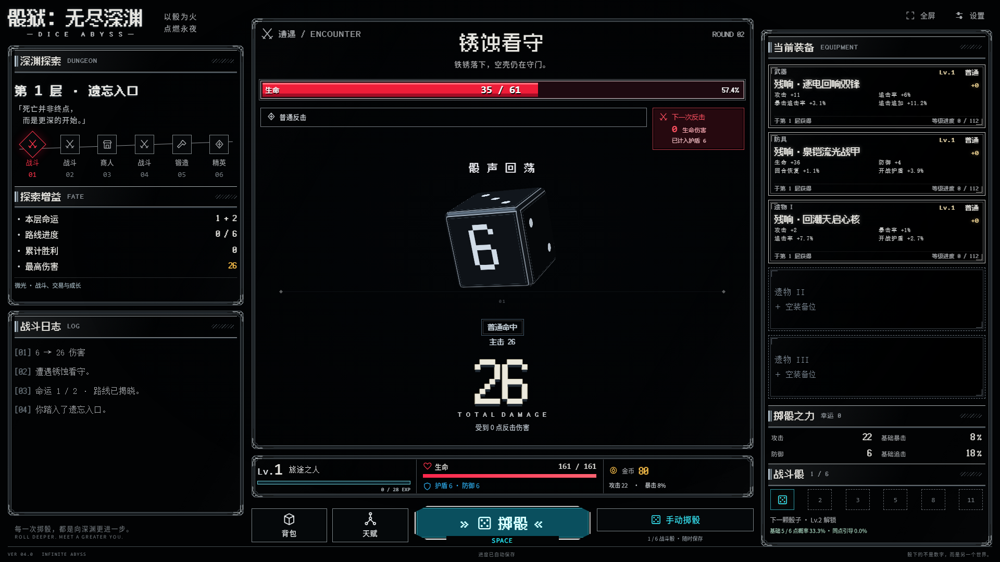
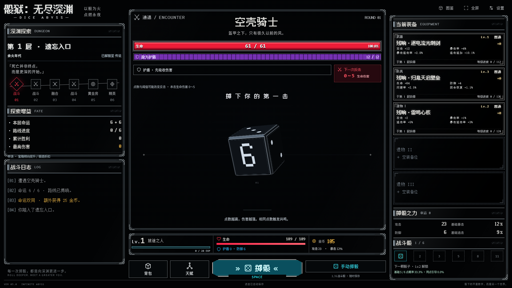

<h1 align="center">🎲 DICE ABYSS</h1>

<p align="center">
  <strong>One more roll. One more room. One more floor into the dark.</strong>
</p>

<p align="center">
  A desktop-first, single-player dice dungeon RPG set in an endless dark-fantasy abyss.<br>
  Cast your fate, roll to fight, open every hard-won chest, and forge the build that takes you deeper.
</p>

<p align="center">
  <a href="https://seiya058904.github.io/Dice-Abyss/"><strong>▶ PLAY IN BROWSER</strong></a>
  &nbsp;·&nbsp;
  <a href="#the-descent">🎮 The Descent</a>
  &nbsp;·&nbsp;
  <a href="#gameplay">📷 Gameplay</a>
  &nbsp;·&nbsp;
  <a href="#how-to-play">⌨️ Controls</a>
  &nbsp;·&nbsp;
  <a href="#for-developers">⚙️ Development</a>
</p>

<p align="center">
  <sub>VERSION 5.1.0 &nbsp;·&nbsp; DESKTOP WEB &nbsp;·&nbsp; MANUAL DICE COMBAT &nbsp;·&nbsp; LOCAL SAVES</sub>
</p>

<p align="center">
  <a href="https://seiya058904.github.io/Dice-Abyss/">
    
  </a>
</p>

---

> **You cannot choose what the dice will show. You can choose what you build around them.**
>
> In **Dice Abyss**, a roll is an attack, a chest is a promise, and every new floor is another test of the equipment and talents you have assembled. The dungeon keeps going. So does your progression.

<a id="the-descent"></a>
## 🎮 The Descent

<p align="center">
  <code>CAST FATE → CROSS SIX ROOMS → ROLL TO FIGHT → CLAIM LOOT → BUILD → DESCEND</code>
</p>

At the start of each floor, **two fate dice** reveal a six-room route. Follow it through battles, services, discoveries, and dangerous encounters. When combat begins, **you decide when to roll**; the actual dice faces determine the strike, and surviving enemies retaliate.

A defeat sends you back into the **same fight**, not back to the beginning. Your earned equipment, gold, talents, and completed rooms remain yours.

<p align="center">
  <strong>UP TO 6 BATTLE DICE</strong> &nbsp;·&nbsp; <strong>50 ROOM TYPES</strong> &nbsp;·&nbsp; <strong>1,536 EQUIPMENT VARIANTS</strong><br>
  <strong>18 BOSSES</strong> &nbsp;·&nbsp; <strong>5 TALENT PATHS / 45 NODES</strong> &nbsp;·&nbsp; <strong>8 RARITIES</strong> &nbsp;·&nbsp; <strong>NO FINAL FLOOR</strong>
</p>

<table>
  <tr>
    <td width="50%" valign="top">
      <h3>🎲 The Roll Is the Attack</h3>
      <p><sub>MANUAL ROLLS · MATCHING FACES · CRITICALS</sub></p>
      <p>Start with one battle die and unlock up to six as you level. Matching faces trigger resonance; high rolls, critical hits, and follow-up strikes become more powerful when your build supports them.</p>
    </td>
    <td width="50%" valign="top">
      <h3>🗺️ A Different Fate Each Floor</h3>
      <p><sub>TWO FATE DICE · SIX-ROOM ROUTES · 50 ROOM TYPES</sub></p>
      <p>Every floor reveals a fresh, ordered route. Meet merchants, forges, relic chambers, trials, strange events, and enemies with distinct combat rules. Richer fate rolls can change the opportunities ahead.</p>
    </td>
  </tr>
  <tr>
    <td width="50%" valign="top">
      <h3>💎 Every Victory Has a Chest</h3>
      <p><sub>1,536 ITEMS · EIGHT RARITIES · FIVE GEAR SLOTS</sub></p>
      <p>Open a chest after every kill. Discover weapons, armor, and relics from Common through Eternal, then combine one weapon, one armor piece, and up to three relics into your own setup.</p>
    </td>
    <td width="50%" valign="top">
      <h3>⚒️ Make the Loot Matter</h3>
      <p><sub>EQUIPMENT LEVELS · FORGING · FUSION</sub></p>
      <p>Strengthen individual items at a forge, or consume spare gear to advance equipment levels through fusion. Invest talent points across five paths focused on high faces, resonance, critical chains, survival, and luck.</p>
    </td>
  </tr>
  <tr>
    <td width="50%" valign="top">
      <h3>👑 Enemies With Rules to Learn</h3>
      <p><sub>18 BOSSES · SECOND PHASES · VISIBLE INTENT</sub></p>
      <p>Prepare for shields, escalating counterattacks, dice-dependent weaknesses, multi-wave fights, and boss phase changes. Enemy warnings expose what is dangerous instead of hiding the rules behind a health bar.</p>
    </td>
    <td width="50%" valign="top">
      <h3>♾️ Progress Without a Reset</h3>
      <p><sub>RETRY THE FIGHT · KEEP YOUR BUILD · DESCEND AGAIN</sub></p>
      <p>Defeat does not erase your journey. The tenth floor marks an early milestone, not the end: deeper floors continue with changing encounters, rewards, and the builds needed to survive them.</p>
    </td>
  </tr>
</table>

## V5: Eight Rarities, Deeper Builds

V5 expands the existing desktop game with **1,536 equipment variants**, **50 room types**, **18 bosses**, and **45 talent nodes across five paths**. The eight equipment rarities are **Common, Rare, Epic, Legendary, Mythic, Ancient, Origin, and Eternal**. Mythic unlocks at floor 30, Ancient at 50, Origin at 80, and Eternal at 140; the four original tiers remain available throughout the descent.

Late-game equipment, room weights, enemy mechanics, talent gates, saves, and the original interface stay part of one playable game. The feature counts describe catalogued content, not that every item, room, or build has received a separate human playtest.

<a id="gameplay"></a>
## 📷 Gameplay

<p align="center">
  <a href="docs/screenshots/gameplay-desktop.png"></a>
</p>
<p align="center"><sub>V4 BASELINE · DESKTOP BROWSER · 1920 × 1080</sub></p>

<p align="center">
  <a href="output/playwright/v5-first-combat-1920.png"></a>
</p>
<p align="center"><sub>V5 LOCAL ACCEPTANCE · DESKTOP BROWSER · 1920 × 1080</sub></p>

**Every number on the dice matters.** Combat uses the rolled values, not a predetermined animation. The interface shows enemy intent and the result of each attack so you can understand how your equipment, talents, and luck affect the outcome.

<a id="how-to-play"></a>
## ⌨️ How to Play

| Input | Action |
| :--- | :--- |
| **Mouse / left click** | Navigate rooms, manage equipment and talents, open chests, and use the main action button. |
| **Roll button** | Roll your available dice to attack during combat. |
| **Space** | Roll during active combat (when no dialog or text control is focused). |
| **Fullscreen button** | Toggle the game display between windowed and fullscreen modes. |
| **Settings** | Adjust sound, effects, and interface scale; export or import your save. |

The current game interface is in **Simplified Chinese**. It is designed for a **landscape desktop browser** with mouse and keyboard; mobile touch gameplay is not a supported target for this release.

<a id="play-now"></a>
## 🚀 Enter the Abyss

<table>
  <tr>
    <td width="50%" valign="top">
      <h3>🌐 Play Online</h3>
      <p><sub>GITHUB PAGES · NO INSTALLATION</sub></p>
      <p>Open the published game in a desktop browser. There is no account, online character, or server-hosted progression to set up.</p>
      <p><strong><a href="https://seiya058904.github.io/Dice-Abyss/">▶ Play Dice Abyss →</a></strong></p>
    </td>
    <td width="50%" valign="top">
      <h3>🖥️ Run from Source</h3>
      <p><sub>WINDOWS / NODE.JS 20+ · LOCAL WEB SERVER</sub></p>
      <p>Clone the repository, launch the small local server, and play on your own machine. A Windows <code>启动游戏.cmd</code> launcher is also included.</p>
      <p><strong><a href="#run-locally">⚙️ Local setup →</a></strong></p>
    </td>
  </tr>
</table>

<a id="your-progress"></a>
### 💾 Your Progress Stays Yours

Progress is saved automatically in **your browser's local storage**. You can export or import a JSON save from Settings; supported **V1–V4** saves migrate to V5 while preserving a pre-migration archive.

> [!IMPORTANT]
> **Local saves are not cloud saves.** GitHub Pages and `http://127.0.0.1:4188` use separate browser origins, so their saves do not sync. Export your save before clearing site data, switching browsers or profiles, or starting over. Importing a save replaces the active local progress after confirmation.

The game has **no account system, analytics, or remote runtime dependency**. All gameplay and save data stay in the browser environment in which you play.

<a id="run-locally"></a>
## 🛠️ Run Locally

Requires **Node.js 20 or newer**. There are no npm runtime packages to install and no build step.

```bash
git clone https://github.com/seiya058904/Dice-Abyss.git
cd Dice-Abyss
npm start
```

Open **http://127.0.0.1:4188** in a desktop browser. On Windows, you can alternatively double-click [`启动游戏.cmd`](启动游戏.cmd) after installing Node.js.

<details>
<summary><strong>Change the port / understand local hosting</strong></summary>

In PowerShell:

```powershell
$env:PORT = '4190'
npm start
```

The server listens on `127.0.0.1`, not on the public network. Serve the project over HTTP instead of opening `index.html` as a `file://` URL; the game uses JavaScript modules, and browser storage is tied to the page origin.

</details>

<a id="for-developers"></a>
## ⚙️ For Developers

Dice Abyss is built with **vanilla JavaScript modules, HTML, and CSS**, with locally bundled fonts. It does not require a framework, bundler, or package installation to run.

<details>
<summary><strong>📂 Expand source layout, checks &amp; deployment notes</strong></summary>

### Repository map

| Path | Purpose |
| :--- | :--- |
| [`src/engine.js`](src/engine.js), [`src/content.js`](src/content.js) | Dice combat, progression, talents, and core content. |
| [`src/equipment.js`](src/equipment.js), [`src/equipment-content.js`](src/equipment-content.js) | Gear generation, levels, item properties, and equipment catalog. |
| [`src/encounters.js`](src/encounters.js) | Special enemy mechanics, event choices, and room generation. |
| [`src/storage.js`](src/storage.js) | Validated local saves, backup behavior, and legacy migration. |
| [`src/app.js`](src/app.js), [`src/views.js`](src/views.js) | Player interaction, menus, screens, and rendering. |
| [`src/dice-renderer.js`](src/dice-renderer.js), [`src/dice-motion.js`](src/dice-motion.js), [`src/effects.js`](src/effects.js) | Dice visuals, motion, and feedback. |
| [`src/`](src/) CSS files | Layout, presentation, responsiveness, and visual refinements. |
| [`scripts/`](scripts/), [`tests/`](tests/) | Local server, simulation, audits, and automated test coverage. |
| [`src/fonts/`](src/fonts/) | Bundled font files and their independent license notices. |

### Verify the source

```bash
npm run check
npm test
npm run simulate -- 1000
```

These commands perform JavaScript syntax checks, Node.js tests, and a 1,000-run simulation. The workflow runs them for pull requests; it assembles and deploys the Pages site only after a push to `main`.

### V5 acceptance and verification limits

The recorded local Chrome acceptance covers the first-floor flow, four deep rarity rewards, five talent paths, forging and relic fusion, ten new deep events, a synthetic V4 save import, and full-inventory save recovery. Deep-floor checks used isolated debug saves. See the [V5 integration and browser acceptance report](docs/v5/集成与实机验收.md) and its linked screenshots for the environment and evidence.

The PR #2 review rerun also used isolated browser saves to verify first-crit luck across a chest, room transition, and refresh; import and claim of a synthetic V4 pending chest; and an Eternal reward opening that remained claimed after refresh. See the [cross-room luck screenshot](output/playwright/v5-p2-01-cross-room-luck.png) and [Eternal reward screenshot](output/playwright/v5-p2-high-rarity-open.png).

Automated checks and isolated browser scenarios do not establish natural long-run progression, every Boss and room combination, migration of a player's private save, or full balance. The Windows launcher, audio listening, and performance on a physical 4K display also remain unverified. Simulated 4K viewport screenshots are layout checks, not hardware performance results.

The deployment assembles a static site from `index.html`, `favicon.svg`, and `src/`. The README, tests, and development scripts are not included in the published game artifact. A successful automated run does **not** imply that long-form manual playtesting or every device configuration has been verified.

</details>

## 📌 Scope & Known Limits

- **Desktop first:** landscape desktop browsers are the intended experience; mobile touch is not a release target.
- **Performance:** stable native 4K at 60 FPS is not claimed. Simulated 4K long-frame performance remains an open limitation.
- **Playtesting:** natural progression into deep floors, every Boss/room combination, varied player builds, and extended human balance testing remain open.
- **Compatibility:** private player saves and the native Windows `.cmd` launcher have not been validated as part of the recorded V5 acceptance.
- **Audio and display performance:** audio has not received a listening review; simulated 4K viewport checks do not verify physical 4K frame rate or long-session performance.
- **Endless descent:** there is no designed final floor, but browser storage, memory, and numeric limits still apply.

## 📜 Licensing

**This repository does not grant a project-wide open-source license.** Public source availability should not be treated as permission to redistribute or reuse the game code and assets.

The included fonts retain their separate **SIL Open Font License 1.1** terms and notices. See [`src/fonts/README.md`](src/fonts/README.md) for their sources and license files. Those font permissions do not extend to the rest of the project.

---

<p align="center">
  <sub>ROLL. REBUILD. DESCEND.</sub><br>
  <sub>Dice Abyss · The next floor is waiting for your next roll.</sub>
</p>
