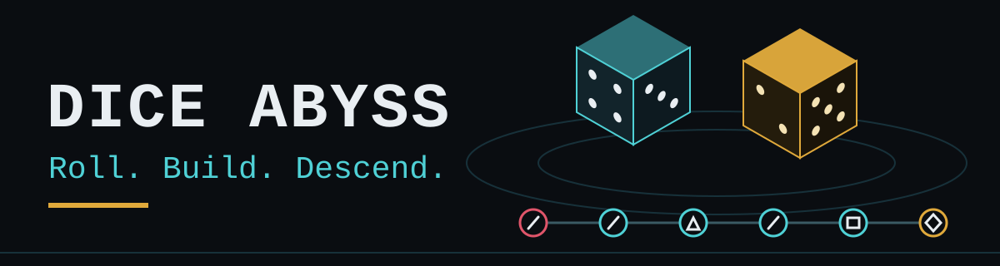
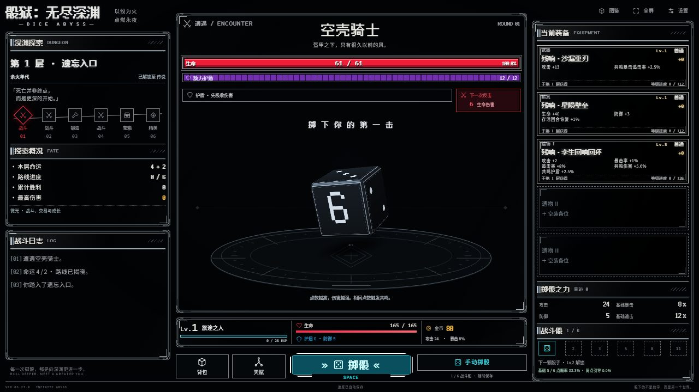

<p align="center">
  
</p>

A single-player dice dungeon RPG for the desktop browser. You choose when to roll; the faces you roll decide the strike, and the equipment and talents you build decide how deep the run can go.

**[Play online](https://seiya058904.github.io/Dice-Abyss/)** · [Run locally](#run-locally) · [How to play](#how-to-play) · [Known limits](#known-limits)

[](https://github.com/seiya058904/Dice-Abyss/actions/workflows/pages.yml)

Current release: **5.27.0** (see `package.json`). The game interface is in Simplified Chinese; this README is in English. There are no accounts, servers, analytics, or runtime dependencies, and progress is saved in your browser.



*First-floor combat in the V5.27 build, captured at 1280×720 from a fresh browser profile.*

## Features

- **Manual dice combat.** Combat never rolls on its own. You press the Roll button or Space, and the face values drive the damage. Matching faces trigger resonance, and critical hits and follow-up strikes scale with your build.
- **Up to six battle dice.** You start with one and unlock more as you level.
- **A six-room route per floor.** Two fate dice are rolled at the start of each floor, and the route is revealed before you enter it. The game defines 50 room types, including fights, forges, chests, events, and elites.
- **Eight rarities and 1,536 equipment entries.** Weapons, armor, and relics each have 512 entries. You equip one weapon, one armor piece, and up to three relics. Mythic loot starts at floor 30, Ancient at 50, Origin at 80, and Eternal at 140.
- **Forging and fusion.** Strengthen an item at a forge, or consume spare gear in fusion to advance equipment levels.
- **Five talent paths, 45 nodes.** The paths cover high faces, resonance, critical chains, survival, and luck.
- **18 bosses with visible intent.** Enemies telegraph their next attack, and some have shields, multiple waves, or second phases.
- **No reset on defeat.** A defeat returns you to the same fight and keeps your equipment, gold, talents, and completed rooms. There is no final floor.

The counts above come from the game's content tables in `src/`. They describe catalogued content, not that every item, room, or build has had a separate human playtest.

## How to Play

Each floor follows this loop: **cast fate, cross six rooms, roll to fight, claim loot, build, descend.**

| Input | Action |
| :--- | :--- |
| Mouse | Navigate rooms, manage equipment and talents, open chests, and press the main action button. |
| Roll button | Roll your available dice in combat. |
| Space | Roll during active combat, when no dialog or text control has focus. |
| Fullscreen button | Switch between windowed and fullscreen. |
| Settings | Adjust sound, effects, interface scale, and Fast Pace; export or import a save. |

Fast Pace plays dice rolls and major effects at twice the normal speed and is saved in the current browser. Narrow windows are supported with vertical scrolling. The game is built desktop-first, and physical phones and touch devices have not been validated.

## Saves and Privacy

Progress is saved automatically in your browser's local storage. Settings can export or import a JSON save, and supported V1–V4 saves migrate to V5 with a pre-migration archive. **Settings → Check Capacity** reports the exact size of the current export. The game never trims items or unknown fields to make a save fit.

> [!IMPORTANT]
> Local saves are not cloud saves. The GitHub Pages site and `http://127.0.0.1:4188` are different browser origins and do not share progress. Export your save before clearing site data, switching browsers or profiles, or importing another save, which replaces the active progress after confirmation.

## Run Locally

**Prerequisites:** Node.js 20 or newer. There are no npm runtime packages and no build step.

```bash
git clone https://github.com/seiya058904/Dice-Abyss.git
cd Dice-Abyss
npm start
```

Open <http://127.0.0.1:4188/> in a desktop browser. On Windows you can also double-click [the Windows launcher](%E5%90%AF%E5%8A%A8%E6%B8%B8%E6%88%8F.cmd).

To use another port, set `PORT` first (PowerShell: `$env:PORT = '4190'; npm start`). The server listens on `127.0.0.1` only. Serve the game over HTTP rather than opening `index.html` as a `file://` URL: it uses JavaScript modules, and browser storage is tied to the page origin.

## Development and Verification

The game is native JavaScript modules, HTML, and CSS with bundled fonts. Run the repository checks with Node.js 20 or newer (CI uses Node 22):

```bash
npm run check             # JavaScript syntax checks for src/ and scripts/
npm test                  # Node.js test suite
npm run simulate -- 1000  # 1,000 seeded ten-floor adventures
```

| Path | Purpose |
| :--- | :--- |
| [`src/engine.js`](src/engine.js), [`src/content.js`](src/content.js), [`src/deep-content.js`](src/deep-content.js) | Combat, progression, talents, and game content. |
| [`src/equipment.js`](src/equipment.js), [`src/equipment-content.js`](src/equipment-content.js) | Gear generation, levels, and the equipment catalog. |
| [`src/encounters.js`](src/encounters.js) | Special enemy mechanics, event choices, and route generation. |
| [`src/storage.js`](src/storage.js) | Validated saves, backup behavior, and legacy migration. |
| [`src/app.js`](src/app.js), [`src/views.js`](src/views.js) | Interaction, screens, and rendering. |
| [`src/fusion-controller.js`](src/fusion-controller.js), [`src/inventory-query.js`](src/inventory-query.js) | Fusion planning and inventory filtering. |
| [`src/dice-renderer.js`](src/dice-renderer.js), [`src/effects.js`](src/effects.js) | Dice visuals, motion, and feedback. |
| [`scripts/`](scripts/), [`tests/`](tests/) | Local server, simulation, audits, and automated tests. |
| [`src/fonts/`](src/fonts/README.md) | Bundled fonts and their license notices. |

The [Pages workflow](.github/workflows/pages.yml) verifies pull requests and pushes to `main`; only a `main` push deploys the site, which contains `index.html`, `favicon.svg`, and `src/`. For browser QA, use an external Playwright installation and fresh contexts, and keep generated output outside the repository; see [`scripts/qa-core-browser.mjs`](scripts/qa-core-browser.mjs) and [AGENTS.md](AGENTS.md).

### Verification Record

Each result applies to its recorded version, environment, and date.

- **V5.27 release:** [PR #3](https://github.com/seiya058904/Dice-Abyss/pull/3) was merged, and its [verification and Pages deployment run](https://github.com/seiya058904/Dice-Abyss/actions/runs/39560017038) passed. See the [final delivery report](FINAL-V527.md) and [verification record](verification-final-v527.json).
- **2026-10-20 acceptance** ([run](https://github.com/seiya058904/Dice-Abyss/actions/runs/39415336338), commit [`f21c3dd`](https://github.com/seiya058904/Dice-Abyss/commit/f21c3dd98700d93383466d4bb5cac12dd9bb27ee)): 926 tests without failures or skips, and 1,000 of 1,000 seeded ten-floor adventures completed. A live check of the published V5.26.0 passed 43 main-flow browser checks in fresh Chromium contexts.
- **2026-10-21 audit follow-up:** when a browser denies access to `localStorage`, the game now shows its save warning and recovery screen instead of a blank page. See the [audit](docs/audits/2026-10-21.md).
- **Open failures kept as evidence:** the strict zero-tolerance RGBA pixel comparison failed and was never relabeled as a pass ([pixel records](PIXEL-ROUND28.md)). A performance candidate was rolled back ([engineering report](ENGINEERING-REPORT-ROUND28.md), [performance record](PERFORMANCE-ROUND28.md)).
- **Further records:** the [cloud iteration report](docs/iteration/LATEST_REPORT.md), the [V5 browser acceptance report](docs/v5/%E9%9B%86%E6%88%90%E4%B8%8E%E5%AE%9E%E6%9C%BA%E9%AA%8C%E6%94%B6.md), the [archive guide](docs/ARCHIVE.md), and the earlier [V4/V5 screenshots](output/playwright/README.md) (historical captures, not the current build).

## Known Limits

- **Platforms:** desktop browsers are the target. Narrow layouts have simulated-viewport checks only; physical phones, pens, and screen readers are unvalidated.
- **Performance:** stable 4K at 60 FPS is not claimed. Simulated 4K long frames and software-rendered frame tails remain open.
- **Playtesting:** automated journeys reach deep floors, but every boss and room combination, varied human builds, and long-run balance remain untested by people.
- **Not validated:** the Windows `.cmd` launcher, audio quality, long-session memory use, and private player saves.
- **Endless descent:** there is no designed final floor, but browser storage, memory, and numeric limits still apply.

## License and Credits

This repository does not grant a project-wide open-source license. Public source access is not permission to redistribute or reuse the game code or assets. The bundled fonts keep their separate SIL Open Font License 1.1 terms; see [`src/fonts/README.md`](src/fonts/README.md). Those permissions do not extend to the rest of the project.
