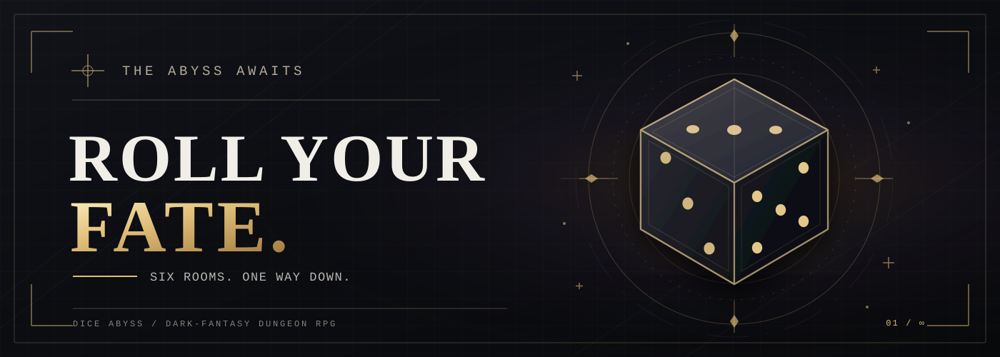
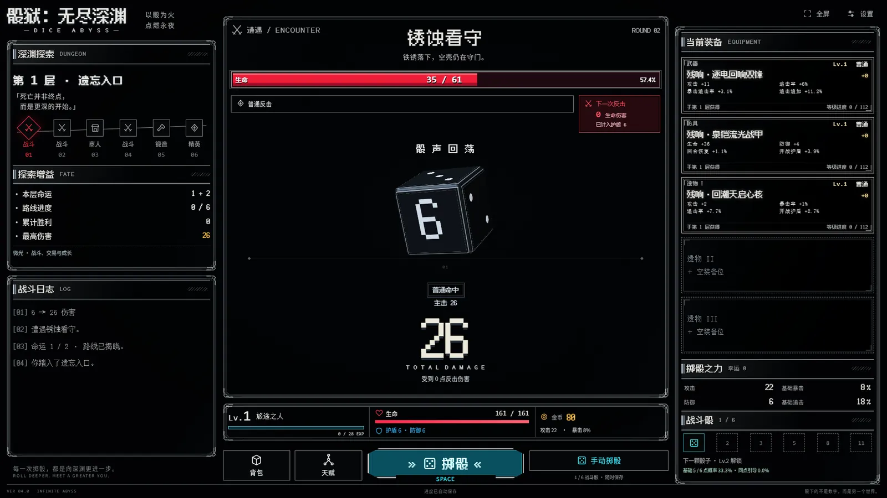
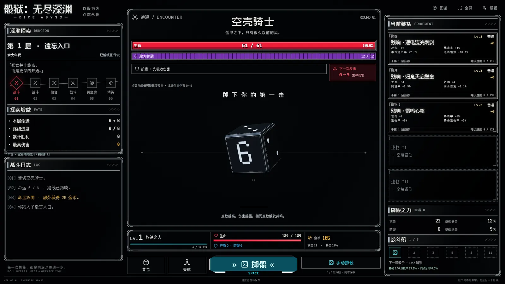

<h1 align="center">🎲 DICE ABYSS</h1>

<p align="center">
  <strong>One more roll. One more room. One more floor into the dark.</strong>
</p>

<p align="center">
  A desktop-first, single-player dice dungeon RPG set in an endless dark-fantasy abyss.<br>
  Cast your fate, roll to fight, open every hard-won chest, and forge the build that takes you deeper.
</p>

<p align="center">
  <a href="https://seiya058904.github.io/Dice-Abyss/"><strong>▶ Play in Your Browser</strong></a>
  &nbsp;·&nbsp;
  <a href="#the-descent">🎮 The Descent</a>
  &nbsp;·&nbsp;
  <a href="#gameplay">📷 Gameplay</a>
  &nbsp;·&nbsp;
  <a href="#how-to-play">⌨️ Controls</a>
  &nbsp;·&nbsp;
  <a href="#for-developers">⚙️ Development</a>
</p>

<p align="center">
  <sub>VERSION 5.27.0 &nbsp;·&nbsp; DESKTOP WEB &nbsp;·&nbsp; MANUAL DICE COMBAT &nbsp;·&nbsp; LOCAL SAVES</sub>
</p>

<p align="center">
  <a href="https://seiya058904.github.io/Dice-Abyss/">
    
  </a>
</p>


## ✨ Current Release · V5.27

**A lighter first load, with an optional faster pace.** Core-font loading reduces the initial font payload. Enable **Fast Pace** in the top-right Settings panel to play complete dice rolls and major effects at twice their normal pace, independently of effect quality. Rewards remain on the result screen until you continue. Standard pace remains the default, and your preference is saved in the current browser.

[PR #3](https://github.com/seiya058904/Dice-Abyss/pull/3) was merged, and its [V5.27 verification and Pages deployment](https://github.com/seiya058904/Dice-Abyss/actions/runs/39560017038) passed. See the [final delivery report](FINAL-V527.md) and [verification record](verification-final-v527.json) for measured improvements, acceptance scope, and limitations.

Earlier no-merge/no-deployment boundaries describe the pre-release handoff. Historical zero-tolerance RGBA **FAIL** results remain diagnostic evidence, never relabeled as PASS: [pixel records](PIXEL-ROUND28.md) · [rollback evidence](ENGINEERING-REPORT-ROUND28.md) · [preserved release history](#release-history).

**2026-10-21 audit follow-up:** Browser policies can deny access to the
`localStorage` property itself. The game now handles that failure through its
existing save warnings and recovery screen instead of stopping on a blank page.
An unsuccessful save cannot start or advance a run; restored access allows an
explicit recovery of the retained progress. See the [audit coverage and checks](docs/audits/2026-10-21.md).

---

> **You cannot choose what the dice will show. You can choose what you build around them.**
>
> In **Dice Abyss**, a roll is an attack, a chest is a promise, and every new floor is another test of the equipment and talents you have assembled. The dungeon keeps going. So does your progression.

<a id="the-descent"></a>
## 🎮 The Descent

<p align="center">
  <code>CAST FATE → CROSS SIX ROOMS → ROLL TO FIGHT → CLAIM LOOT → BUILD → DESCEND</code>
</p>

At the start of each floor, **two fate dice** reveal a six-room route. Follow it through battles, services, discoveries, and dangerous encounters. When combat begins, **you decide when to roll**; the actual dice faces determine the strike, and surviving enemies retaliate.

A defeat sends you back into the **same fight**, not back to the beginning. Your earned equipment, gold, talents, and completed rooms remain yours.

<p align="center">
  <strong>UP TO 6 BATTLE DICE</strong> &nbsp;·&nbsp; <strong>50 ROOM TYPES</strong> &nbsp;·&nbsp; <strong>1,536 EQUIPMENT VARIANTS</strong><br>
  <strong>18 BOSSES</strong> &nbsp;·&nbsp; <strong>5 TALENT PATHS / 45 NODES</strong> &nbsp;·&nbsp; <strong>8 RARITIES</strong> &nbsp;·&nbsp; <strong>NO FINAL FLOOR</strong>
</p>

<table>
  <tr>
    <td width="50%" valign="top">
      <h3>🎲 The Roll Is the Attack</h3>
      <p><sub>MANUAL ROLLS · MATCHING FACES · CRITICALS</sub></p>
      <p>Start with one battle die and unlock up to six as you level. Matching faces trigger resonance; high rolls, critical hits, and follow-up strikes become more powerful when your build supports them.</p>
    </td>
    <td width="50%" valign="top">
      <h3>🗺️ A Different Fate Each Floor</h3>
      <p><sub>TWO FATE DICE · SIX-ROOM ROUTES · 50 ROOM TYPES</sub></p>
      <p>Every floor reveals a fresh, ordered route. Meet merchants, forges, relic chambers, trials, strange events, and enemies with distinct combat rules. Richer fate rolls can change the opportunities ahead.</p>
    </td>
  </tr>
  <tr>
    <td width="50%" valign="top">
      <h3>💎 Every Victory Has a Chest</h3>
      <p><sub>1,536 ITEMS · EIGHT RARITIES · FIVE GEAR SLOTS</sub></p>
      <p>Open a chest after every kill. Discover weapons, armor, and relics from Common through Eternal, then combine one weapon, one armor piece, and up to three relics into your own setup.</p>
    </td>
    <td width="50%" valign="top">
      <h3>⚒️ Make the Loot Matter</h3>
      <p><sub>EQUIPMENT LEVELS · FORGING · FUSION</sub></p>
      <p>Strengthen individual items at a forge, or consume spare gear to advance equipment levels through fusion. Invest talent points across five paths focused on high faces, resonance, critical chains, survival, and luck.</p>
    </td>
  </tr>
  <tr>
    <td width="50%" valign="top">
      <h3>👑 Enemies With Rules to Learn</h3>
      <p><sub>18 BOSSES · SECOND PHASES · VISIBLE INTENT</sub></p>
      <p>Prepare for shields, escalating counterattacks, dice-dependent weaknesses, multi-wave fights, and boss phase changes. Enemy warnings expose what is dangerous instead of hiding the rules behind a health bar.</p>
    </td>
    <td width="50%" valign="top">
      <h3>♾️ Progress Without a Reset</h3>
      <p><sub>RETRY THE FIGHT · KEEP YOUR BUILD · DESCEND AGAIN</sub></p>
      <p>Defeat does not erase your journey. The tenth floor marks an early milestone, not the end: deeper floors continue with changing encounters, rewards, and the builds needed to survive them.</p>
    </td>
  </tr>
</table>

## V5: Eight Rarities, Deeper Builds

V5 expands the existing desktop game with **1,536 equipment variants**, **50 room types**, **18 bosses**, and **45 talent nodes across five paths**. The eight equipment rarities are **Common, Rare, Epic, Legendary, Mythic, Ancient, Origin, and Eternal**. Mythic unlocks at floor 30, Ancient at 50, Origin at 80, and Eternal at 140; the four original tiers remain available throughout the descent.

Late-game equipment, room weights, enemy mechanics, talent gates, saves, and the original interface stay part of one playable game. The feature counts describe catalogued content, not that every item, room, or build has received a separate human playtest.

<a id="gameplay"></a>
## 📷 Gameplay

These are **historical V4/V5 screenshots**, retained as compressed WebP browsing copies with a maximum edge of 1600 pixels. Captions and filenames describe the original capture viewport; these are not captures from the current iteration. See the [historical screenshot notes](output/playwright/README.md).

<p align="center">
  <a href="docs/screenshots/gameplay-desktop.webp"></a>
</p>
<p align="center"><sub>V4 BASELINE · DESKTOP BROWSER · 1920 × 1080</sub></p>

<p align="center">
  <a href="output/playwright/v5-first-combat-1920.webp"></a>
</p>
<p align="center"><sub>V5 LOCAL ACCEPTANCE · DESKTOP BROWSER · 1920 × 1080</sub></p>

**Every number on the dice matters.** Combat uses the rolled values, not a predetermined animation. The interface shows enemy intent and the result of each attack so you can understand how your equipment, talents, and luck affect the outcome.

<a id="how-to-play"></a>
## ⌨️ How to Play

| Input | Action |
| :--- | :--- |
| **Mouse / left click** | Navigate rooms, manage equipment and talents, open chests, and use the main action button. |
| **Roll button** | Roll your available dice to attack during combat. |
| **Space** | Roll during active combat (when no dialog or text control is focused). |
| **Fullscreen button** | Toggle the game display between windowed and fullscreen modes. |
| **Settings** | Adjust sound, effects, and interface scale; export or import your save. |

The current game interface is in **Simplified Chinese**. The game remains desktop-first and now adapts its main screens and controls to narrow browser windows. Long content is available through vertical scrolling. The current iteration report lists the tested viewport and interaction matrix. Physical phones, pens, external screen readers and device-specific touch behavior have not been validated.

<a id="play-now"></a>
## 🚀 Enter the Abyss

<table>
  <tr>
    <td width="50%" valign="top">
      <h3>🌐 Play Online</h3>
      <p><sub>GITHUB PAGES · NO INSTALLATION</sub></p>
      <p>Open the published game in a desktop browser. There is no account, online character, or server-hosted progression to set up.</p>
      <p><strong><a href="https://seiya058904.github.io/Dice-Abyss/">▶ Play Dice Abyss →</a></strong></p>
    </td>
    <td width="50%" valign="top">
      <h3>🖥️ Run from Source</h3>
      <p><sub>WINDOWS / NODE.JS 20+ · LOCAL WEB SERVER</sub></p>
      <p>Extract the complete archive, launch the small local server, and play on your own machine. A Windows command launcher is also included.</p>
      <p><strong><a href="#run-locally">⚙️ Local setup →</a></strong></p>
    </td>
  </tr>
</table>

<a id="your-progress"></a>
### 💾 Your Progress Stays Yours

Progress is saved automatically in **your browser's local storage**. You can export or import a JSON save from Settings; supported **V1–V4** saves migrate to V5 while preserving a pre-migration archive.

Use **Settings → Check Capacity** to inspect the current export's exact file size. A save at the file limit has no growth allowance; recycling or fusion must still produce a result within that limit before it can commit. Export preserves the complete current progress, including supported extra data. The game does not automatically delete items or unknown fields to make a save fit.

> [!IMPORTANT]
> **Local saves are not cloud saves.** GitHub Pages and `http://127.0.0.1:4188` use separate browser origins, so their saves do not sync. Export your save before clearing site data, switching browsers or profiles, or starting over. Importing a save replaces the active local progress after confirmation.

The game has **no account system, analytics, or remote runtime dependency**. All gameplay and save data stay in the browser environment in which you play.

<a id="run-locally"></a>
## 🛠️ Run Locally

Requires **Node.js 20 or newer**. There are no npm runtime packages to install and no build step. Clone or extract the repository, then open a terminal in the folder containing `package.json` and `index.html`:

```bash
npm start
```

Open **http://127.0.0.1:4188** in a desktop browser. On Windows, you can alternatively double-click [the Windows launcher](%E5%90%AF%E5%8A%A8%E6%B8%B8%E6%88%8F.cmd) after installing Node.js.

<details>
<summary><strong>Change the port / understand local hosting</strong></summary>

In PowerShell:

```powershell
$env:PORT = '4190'
npm start
```

The server listens on `127.0.0.1`, not on the public network. Serve the project over HTTP instead of opening `index.html` as a `file://` URL; the game uses JavaScript modules, and browser storage is tied to the page origin.

</details>

<a id="for-developers"></a>
## ⚙️ For Developers

Dice Abyss is built with **vanilla JavaScript modules, HTML, and CSS**, with locally bundled fonts. It does not require a framework, bundler, or package installation to run.

<details>
<summary><strong>📂 Expand source layout, checks &amp; deployment notes</strong></summary>

### Repository map

| Path | Purpose |
| :--- | :--- |
| [`src/engine.js`](src/engine.js), [`src/content.js`](src/content.js) | Dice combat, progression, talents, and core content. |
| [`src/equipment.js`](src/equipment.js), [`src/equipment-content.js`](src/equipment-content.js) | Gear generation, levels, item properties, and equipment catalog. |
| [`src/encounters.js`](src/encounters.js) | Special enemy mechanics, event choices, and room generation. |
| [`src/storage.js`](src/storage.js) | Validated local saves, backup behavior, and legacy migration. |
| [`src/app.js`](src/app.js), [`src/views.js`](src/views.js) | Player interaction, menus, screens, and rendering. |
| [`src/fusion-controller.js`](src/fusion-controller.js), [`src/fusion-workbench.js`](src/fusion-workbench.js), [`src/fusion-view.js`](src/fusion-view.js) | Transient fusion selection, batch planning, previews, and results. |
| [`src/inventory-query.js`](src/inventory-query.js), [`src/inventory-page.js`](src/inventory-page.js), [`src/inventory-render.js`](src/inventory-render.js) | Inventory filtering, sorting, page selection reuse, and DOM updates. |
| [`src/event-risk.js`](src/event-risk.js) | Read-only paid-event probabilities and immediate gold budgets. |
| [`src/dice-renderer.js`](src/dice-renderer.js), [`src/dice-motion.js`](src/dice-motion.js), [`src/effects.js`](src/effects.js), [`src/visual-timeline.js`](src/visual-timeline.js) | Dice visuals, motion, feedback, and presentation cleanup. |
| [`src/`](src/) CSS files | Layout, presentation, responsiveness, and visual refinements. |
| [`scripts/`](scripts/), [`tests/`](tests/) | Local server, simulation, audits, and automated test coverage. |
| [`src/fonts/`](src/fonts/) | Bundled font files and their independent license notices. |
| [`AGENTS.md`](AGENTS.md) | Project-specific development, save-safety, validation, and release guidance. |

<a id="verify-the-source"></a>
### Verify the source

```bash
npm run check
npm test
npm run simulate -- 1000
```

These commands perform JavaScript syntax checks, Node.js tests, and a 1,000-run simulation. The workflow runs them for pull requests; it assembles and deploys the Pages site only after a push to `main`.

**2026-10-20 acceptance:** [GitHub verification and Pages deployment](https://github.com/seiya058904/Dice-Abyss/actions/runs/39415336338) passed for [`f21c3dd`](https://github.com/seiya058904/Dice-Abyss/commit/f21c3dd98700d93383466d4bb5cac12dd9bb27ee): **926 tests**, no failures or skips, and **1,000/1,000 seeded ten-floor adventures completed**. Local Node 22 and Node 24 checks also passed. Before integration, **700 complete synthetic V5.1 save snapshots** were read without state loss; no private player saves were used.

The published **V5.26.0** was checked independently: all **66 shipping resources** matched the local source bytes, including JavaScript, styles, WebP artwork and both fonts. Fresh Chromium contexts passed **43 main-flow checks** covering manual rolls, combat, chest opening, equipment, refresh, inventory, settings, failed writes and cross-tab synchronization. Additional live cases verified importing/resuming fusion history with a missing optional consumption list and a manual double-fate roll at the gold cap. These live cases captured no page or console errors. Isolated local checks also covered fusion, inventory navigation, talents, forge previews, save recovery and window-resize settlement.

Canvas regression checks execute the hash-verified, bundled original and current paint programs under the **same Node runtime**, comparing their complete effective arguments and primitive paint state exactly. This avoids treating the last-bit numeric differences between Node 22 and 24 as a rendering regression; no rounding or numeric tolerance is applied. Historical reference hashes remain unchanged.

For browser work, use an external Playwright installation and fresh browser contexts, and keep generated screenshots and logs outside the repository. [`scripts/qa-core-browser.mjs`](scripts/qa-core-browser.mjs) accepts `--url=<game-url>` and `--output=<external-directory>`. See [AGENTS.md](AGENTS.md) for the validation and publishing boundaries.

The staged-site release gate in `scripts/qa-browser-release.mjs` also checks
malformed URL escapes: its temporary server returns HTTP 400 and continues
serving byte-identical resources after each rejected request. This HTTP check
runs in both Web Locks modes before the browser scenarios.

### Historical V5 acceptance and verification limits

The following paragraphs describe evidence inherited from earlier V5 work. The [cloud iteration report](docs/iteration/LATEST_REPORT.md) records its original reruns and risks; the dated repository and live-site acceptance above records the later integration checks.

The recorded local Chrome acceptance covers the first-floor flow, four deep rarity rewards, five talent paths, forging and relic fusion, ten new deep events, a synthetic V4 save import, and full-inventory save recovery. Deep-floor checks used isolated debug saves. See the [V5 integration and browser acceptance report](docs/v5/%E9%9B%86%E6%88%90%E4%B8%8E%E5%AE%9E%E6%9C%BA%E9%AA%8C%E6%94%B6.md) and its linked screenshots for the environment and evidence.

The PR #2 review rerun also used isolated browser saves to verify first-crit luck across a chest, room transition, and refresh; import and claim of a synthetic V4 pending chest; and an Eternal reward opening that remained claimed after refresh. See the [cross-room luck screenshot](output/playwright/v5-p2-01-cross-room-luck.png) and [Eternal reward screenshot](output/playwright/v5-p2-high-rarity-open.png).

Automated checks and isolated browser scenarios do not establish natural long-run progression, every Boss and room combination, migration of a player's private save, or full balance. The Windows launcher, audio listening, and performance on a physical 4K display also remain unverified. Simulated 4K viewport screenshots are layout checks, not hardware performance results.

The deployment assembles a static site from `index.html`, `favicon.svg`, and `src/`. The README, tests, and development scripts are not included in the published game artifact. A successful automated run does **not** imply that long-form manual playtesting or every device configuration has been verified.

</details>

<a id="release-history"></a>
## 📚 Release History & Measurement Notes

Detailed investigations are retained below so the gameplay overview stays easy to browse. Each result applies to its recorded version, commit, environment, and date.

<details>
<summary><strong>Expand the V5.27 investigation and V5.26 release record</strong></summary>

### V5.27.0 Local Performance Investigation — Historical

**The DRAFT_CONTINUE and blocker statuses below describe the investigation at the time. Current delivery status is summarized near the top of this README.**

**2026-10-21 stabilization: DRAFT_CONTINUE (historical).** The independent browser workflow
now runs on pull requests to `main`, checks out the event's exact head SHA and
asserts that identity. It retains read-only permissions and does not deploy.
Native Web Locks and API-absent modes have separate reports. Browser smoke
results do not certify strict pixels or performance.
The first [remote exact-head browser run](https://github.com/seiya058904/Dice-Abyss/actions/runs/39537223891)
passed both modes at `8826d99`; each passed eight smoke checks and 43 core
assertions. Its [Node 22 verification](https://github.com/seiya058904/Dice-Abyss/actions/runs/39537223794)
passed 946 tests and 1,000 simulations. All production deployment steps were
skipped. These results apply to that recorded SHA.

Core-font QA now requires loaded FontFace objects, successful explicit loads,
resource URLs and Canvas glyph metrics matched to an independently loaded copy
of the Core binary. It records production atlas buffers and rejects synthetic
404/corrupt Core resources; cold, warm and delayed controls are also exercised.
The older Canvas font-string check alone was insufficient evidence of the font
actually used. The external stage profiler now rejects an unmatched Web Locks
hook instead of silently omitting that timing, with LF/CRLF regression coverage.
No gameplay, storage, font binary or production deployment change is included
in this stabilization. Strict RGBA and the 10k salvage completion tail remain
open release blockers; the PR remains Draft.

The bounded follow-up on **2026-10-20**, based on `042a64f`, successfully
used the existing Playwright runner through ordinary execution permissions.
The previous policy block remains historical evidence; it is not the status
of this follow-up. No additional game/runtime change was justified.

Four isolated arms (V5.26, fonts only, storage only, full V5.27) retained two
independent batches of 12 pairs for 100 items, plus 12 pairs for 1k/10k, each
with and without additional clone/Storage instrumentation. For 100-item open,
full-minus-original paired p50 was **+2.2 ms / -1.3 ms** in the two batches;
combined open p50 was **61.8 → 63.0 ms**. The earlier +25.1 ms median regression
was not stably reproduced. Small samples and bimodal RAF scheduling limit
absence claims; this does not establish universal speedups.

For 10k, lock click-to-second-RAF p50 was **103.7 → 95.7 ms**, while mirror
write-return p50 was **68.2 → 61.6 ms**. Opening was **64.1 → 66.6 ms**.
Recycling's second RAF sometimes precedes commit: its p50 **35.5 → 133.7 ms**
must be retained, but mirror return was **106.3 → 101.6 ms** and commit-plus-two-
RAF **154.2 → 150.1 ms**. The latter maximum worsened **180.8 → 190.8 ms**.
All adverse samples remain in external evidence. Quantiles use
`floor((n-1)*p)`; at n=12 p95 and p99 are both the second-largest sample.

Strict pixels remain **FAIL**, not a waived or relaxed PASS. Two cross-version
runs had 4/7 and 2/6 valid RGBA failures; the second run's original motion-240
source request failed with ECONNRESET and supplied no valid pixel pair.
Original self-comparisons failed 4/7 twice; V5.27 self-comparisons failed 2/7
and 5/7. Final RGBA deviations were at most one channel step with unchanged
alpha. Atlas readback also varied by one alpha step within the same version;
all ready uploads used Abyss Pixel digits 1–6. The terminal case passed both
cross comparisons but failed both V5.27 self comparisons; its original self
pairs were exact, so this case is not labelled proven original-version noise.
Other differing cases have original-version variability in this matrix.
No stable, substantial V5.27-only visual shift was demonstrated. Round26's
2/7 and earlier V5.27 5/7 are historical runs, not directly subtractable rates.

The corrected font-browser run passed exact geometry and zero repeat noise at
all four viewports, normal Full requests remained zero, and missing-character
Full/system fallback passed. Its first attempt is retained as a setup failure
(missing `--derivation` argument), not a font regression. At 1920×1080 the new
cold FCP samples were **244/232 → 168/160 ms** on loopback SwiftShader.

`scripts/qa-performance-round27.mjs` accepts `--fonts=URL` and `--storage=URL`
with `--baseline=URL`, `--current=URL`, `--sizes=100,1000,10000 --pairs=12`
and an external `--output`. It rotates all arms and instrumentation order,
retains warmups, and separates primary/mirror return from both RAF clocks.
CDP CPU/style/layout metrics cover the surrounding automation window, and
`setItem` return does not prove physical disk fsync. Optional `--settle=true`
is a separate diagnostic, never a replacement for immediate-open samples.
`qa-surface-regression-round26.mjs --atlas-diagnostic` additionally preserves
atlas buffers, font-ready state and upload/draw/read call order symmetrically.
`diagnose-rgba.py --report REPORT --output NEW_FILE` verifies buffer hashes and
records every changed pixel without changing the zero-tolerance verdict.

The local version adds **364,264 bytes of core fonts** (35,560 Pixel + 328,704
Text), while retaining the original 8,656,928 bytes of complete fonts for
on-demand missing-character fallback. Only cores are preloaded. All 113 CSS
core references, including nested `var()` fallbacks, retain the matching Full
family and their original system-font order. Source Han's variable axes and
four tested weights are retained; derivative family and named-instance
PostScript names avoid its Reserved Font Name. See [font notices](src/fonts/README.md).

Large saves can avoid an extra UTF-8 buffer when a conservative byte bound
already proves they fit. Uncertain inputs retain the exact encoder check.
Complete snapshot comparisons, serialization, both storage writes, migration
and failure behavior remain unchanged. An experimental raw-payload comparison
shortcut was rejected by existing Proxy/rawJSON conflict tests and is **not**
part of this version.

The independent `browser-release-qa.yml` workflow runs for pull requests to
`main` and via `workflow_dispatch`. It installs Playwright 1.60.0 outside the game, assembles
and hashes the exact HEAD shipping files, and checks real browser play,
10k inventory locking, mirrored saves and reload. It does not deploy or change
the existing Pages workflow. Performance is reported separately, without a
random p95 release gate.

Reproduction uses external `PLAYWRIGHT_MODULE`, `CHROMIUM_PATH` and fresh
external `--output` directories: `qa-fonts-round27.mjs` compares two loopback
origins; `qa-performance-round27.mjs` retains 12 paired samples plus warmups
for 100/1k/10k inventories (`--sizes=100,1000,10000`); and
`prepare-stage-probe.mjs <external-copy>` instruments only an isolated copy.
`benchmark-storage-round27.mjs` retains the original storage differential
scenarios and reports Node timings only. Raw QA logs are not shipped.

Earlier implementation acceptance (historical, before the bounded follow-up)
on **2026-10-20** used Windows, Ryzen 7 9700X,
Chromium **156.0.8078.4**, ANGLE **SwiftShader**, DPR 1 and disposable saves.
The font comparison repeated each of 1366×768, 1920×1080, 3840×2160 and
390×844 twice: text rectangles, line breaks, cards and scroll geometry were
exactly equal, with zero repeat-layout noise. Normal flows requested no Full
font; the imported-name probe used Fusion Pixel Full, a Text probe used Source
Han Full, and an unsupported emoji used the system font. Each Full was fetched
once. At 1920×1080, cold CDP font bytes fell **8,657,387 → 364,721 (95.79%)**;
FCP was **212/204 → 140/136 ms** in the two local samples. These are loopback
identity-encoding measurements, not published-CDN or universal startup claims.
Keeping Full fonts means the total deployment grows despite lower first-load
traffic.

That earlier two-arm interaction comparison retained **12 pairs per action/size/probe
mode**, one warmup each, and all tails. For 10k equipment, click-to-second-RAF
lock p50/p95 was **95.3/113.3 → 100.9/108.4 ms**, equip **89.5/92.2 →
89.8/92.1 ms**, and opening **62.9/67.4 → 63.9/68.4 ms**. Recycling confirmation
through durable mirror write and two RAFs improved **148.9/152.2 →
143.6/145.7 ms**. The 1k lock/equip medians rose **53.9/38.1 → 57.4/41.4 ms**.
These mixed results do **not** establish a general interaction speedup.
The capacity change removes one UTF-8 allocation from the 10k reference save;
both parses, all four serializations, and primary/mirror writes remain.

942 Node tests, 1,000 ten-floor simulations and 43 storage differential
scenarios passed. Native context restoration and all 16 surface functional
cases passed; the 19 supplied-motion cases matched. Strict RGBA still failed
5 of 7 cross-version image comparisons and 3 of 7 same-version comparisons
(the eighth pair is a non-RGBA effects case). Those failures remain open,
along with the historical deep 4×400 completion limit, physical-GPU 4K/60 FPS,
long-term memory and balance. No remote workflow or Pages deployment was run
in that historical local acceptance.

The V5.26.0 section below is historical; current delivery status is recorded above.

### V5.26.0 · Reviewed, Integrated & Published — Historical

The reviewed **V5.26.0 cloud handoff** has been integrated into this repository and published to [GitHub Pages](https://seiya058904.github.io/Dice-Abyss/). Publication and live browser checks passed on **2026-10-20**. Follow [Run Locally](#run-locally) to run the same game on your computer; browser saves remain separate between the local and published origins.

**Two integration fixes protect existing progress and clarify rewards.** A readable fusion save without its optional historical material list can now resume without a rendering error; the interface explicitly says the old consumption count was not recorded. Double-fate rewards show their nominal amount and explain the gold cap, instead of claiming the full amount was received when part or all of it was clipped. These fixes preserve the game rules, RNG and save schema.

**Sort a large inventory with fewer repeated calculations.** Each matching item is valued at most once per sort; rarity and level sorts only calculate strength when their primary values tie. Strength, rarity and level ordering retain their original tie rules, filters and complete sixty-card pages. Search and filter actions calculate fresh results; consecutive paging still uses the existing selection reuse.

**Reuse a proven dice envelope.** Moving dice first use a conservative containment check. When the existing canvas already encloses the complete projected motion, it keeps the same bounds and skips the detailed corner calculations. A pose that might extend beyond it takes the original exact path. Resting detail, dice geometry and the shaders remain intact.

**Keep the previous presentation safeguards.** Offscreen rendering, repeated motion sampling, on-demand recycling, and resize settlement remain protected. A resized presentation reveals its saved result once and restores the available controls. Primary and mirror saves still use the complete transaction checks.

**Retain an auditable handoff.** Game assets, offline fonts and licenses, regression tests, reconstruction inputs and important earlier failure evidence remain included. Historical cloud reports retain their original measurements and limitations; current repository acceptance is described under [Verify the source](#verify-the-source).

The inventory retains its existing stable layout. Earlier `content-visibility` experiments caused scroll-position jumps and remain excluded. Large inventory layout costs and software-renderer frame tails are still tracked as open risks.

Complete snapshot conflict checks, primary and mirror saves, Web Locks, V1–V4 migration, equipment IDs, unknown save fields, manual combat, six-room routes and eight rarity gates remain supported. The save format is still version 5.

See [the inherited cloud iteration report](docs/iteration/LATEST_REPORT.md) for comparable performance measurements and remaining limits. Supplied high-frequency callback counts and software-rendered browser timings do not establish physical GPU FPS or universal performance gains.

Historical documentation was curated locally on 2026-10-23. See the [retained essentials and recovery guide](docs/ARCHIVE.md) for the remaining evidence, unchanged failure conclusions, and restoration of retired files.

[STATE.json](docs/iteration/STATE.json) and [FILE_MANIFEST.json](docs/iteration/FILE_MANIFEST.json) describe the **received cloud archive**, before the local integration fixes. Git commits identify the maintained repository. Regenerate a manifest when creating a new archive; do not treat the old manifest as a hash list for later repository changes.

</details>

## 📌 Scope & Known Limits

- **Desktop first:** narrow-window layouts are available and have simulated-viewport interaction checks; physical phones, pens and device-specific touch behavior remain unverified.
- **Performance:** stable native 4K at 60 FPS is not claimed. Simulated 4K long-frame performance remains an open limitation.
- **Playtesting:** reproducible automated journeys reach deep floors, but every Boss/room combination, varied human builds and extended human balance testing remain open.
- **Compatibility:** private player saves and the native Windows `.cmd` launcher have not been validated as part of the recorded V5 acceptance.
- **Audio and display performance:** audio has not received a listening review; simulated 4K viewport checks do not verify physical 4K frame rate or long-session performance.
- **Endless descent:** there is no designed final floor, but browser storage, memory, and numeric limits still apply.

## 📜 Licensing

**This repository does not grant a project-wide open-source license.** Public source availability should not be treated as permission to redistribute or reuse the game code and assets.

The included fonts retain their separate **SIL Open Font License 1.1** terms and notices. See [`src/fonts/README.md`](src/fonts/README.md) for their sources and license files. Those font permissions do not extend to the rest of the project.

---

<p align="center">
  <sub>ROLL. REBUILD. DESCEND.</sub><br>
  <sub>Dice Abyss · The next floor is waiting for your next roll.</sub>
</p>
